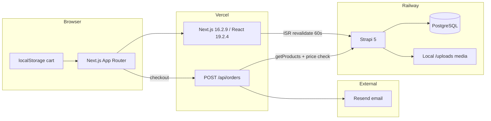
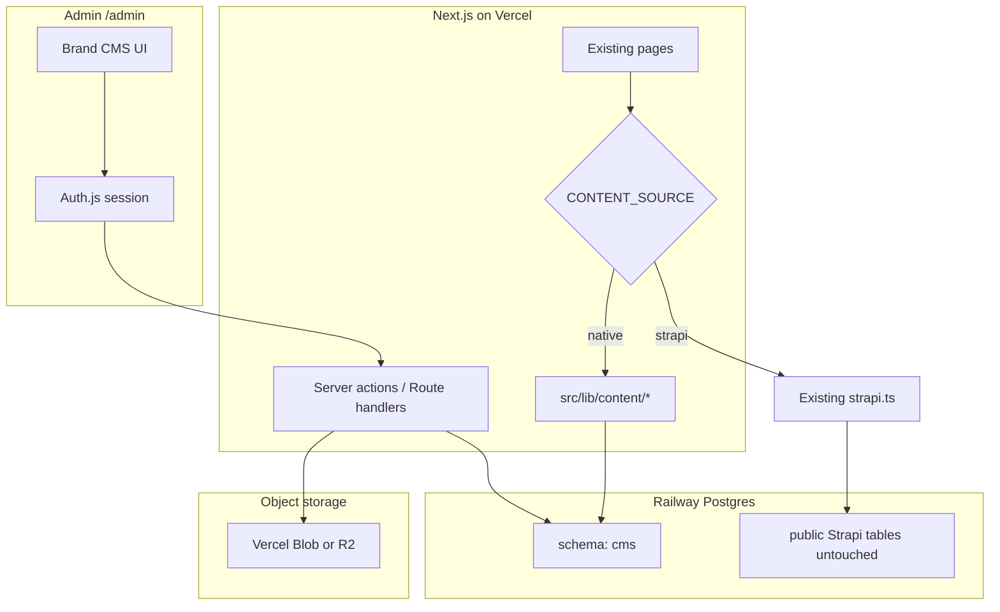

# Mang Crinkle — Native CMS Phase 1 Audit

**Date:** 2026-10-20  
**Repo:** [shaygail/mangcrinkle](https://github.com/shaygail/mangcrinkle)  
**Production site:** https://mangcrinkle.vercel.app  
**Strapi (live):** `strapi-production-2a0b.up.railway.app`  
**Status:** Investigation only — no production data modified.

---

## 1. Current architecture



| Layer | Reality in repo |
|-------|-----------------|
| Storefront | Next.js App Router under `src/app/` — `/`, `/shop`, `/shop/[productId]`, `/shop/build/[packId]`, `/cart`, `/checkout`, `/order/confirmation` |
| Styling | Tailwind 4 + `mang-*` tokens in `src/app/globals.css`; Bebas Neue + Open Sans |
| CMS | Strapi 5 in `strapi/` on Railway, Postgres via `DATABASE_URL` |
| Cart | Client `CartContext` + `localStorage` — not in any DB |
| Orders | `POST /api/orders` → server-side price validation → Resend emails only |
| Payments | Preference only (GCash / card / pay at pickup) — no Stripe/payment processor |
| Auth (storefront) | None |
| Auth (admin) | Strapi admin only (`/admin` on Railway host) |
| Tests / CI | No `.github` workflows, no test runner in root `package.json` |
| Deploy | Next on Vercel (documented); Strapi + Postgres on Railway; root `railway.toml` also exists for Next |

**Critical finding:** Strapi owns **catalogue and marketing content only**. It does **not** store orders, payments, or cart state. Order fulfilment today is email + client confirmation session (`order-session`).

---

## 2. Existing database dependencies

| Consumer | Database | Tables / content |
|----------|----------|------------------|
| Strapi service | Railway Postgres (`DATABASE_URL` in Strapi env) | Strapi system tables + content tables (`products`, `homepages`, `shop_pages`, `storefront_copies`, `store_outlets`, `testimonials`, `order_steps`, upload/files, users-permissions, etc.) |
| Next.js app | **None today** | Reads Strapi over HTTP only (`STRAPI_URL`, `STRAPI_API_TOKEN`) |
| Orders | **None** | Ephemeral email delivery |

**Implication:** Native CMS can safely use the **same Railway Postgres instance** with a dedicated schema (e.g. `cms`) without touching Strapi tables. Do not drop or migrate Strapi tables during cutover.

**Media:** Strapi upload provider is **local** (`strapi/config/plugins.js`). Images are served from `{STRAPI_URL}/uploads/**`. Next `images.remotePatterns` already allow `**.up.railway.app/uploads/**`. Vercel filesystem is ephemeral — new uploads must go to object storage (Vercel Blob / S3 / R2), not the Next app disk.

---

## 3. Strapi content types and relationships

Live API probe (2026-10-20): **33 products** publicly readable; homepage single type populated.

### Collection types

| Type | API | Key fields | draftAndPublish |
|------|-----|------------|-----------------|
| **Product** | `/api/products` | `productId` (stable storefront id), `name`, `description`, `price` (decimal NZD), `category` enum, `tier`, `badge`, `note`, `image`, `featuredOnShop`, `shopSortOrder`, `showInBoxBuilder`, `boxBuilderSortOrder`, `builderTitle`, `builderSubtitle` | **false** |
| **Testimonial** | `/api/testimonials` | `quote`, `author`, `sortOrder` | false |
| **Order Step** | `/api/order-steps` | `stepNumber`, `title`, `emoji`, `description`, `sortOrder` | false |

### Single types

| Type | API | Purpose |
|------|-----|---------|
| **Homepage** | `/api/homepage` | Announcement, hero, story, how-to-order titles, testimonials title, CTA, merch titles, footer links/social, SEO `siteDescription`, images |
| **Shop Page** | `/api/shop-page` | Shop header + section blurbs |
| **Storefront Copy** | `/api/storefront-copy` | Cart / checkout / confirmation copy |
| **Store Outlet** | `/api/store-outlet` | Pickup location, hours, address, pickup windows |

### Relationships (logical, not DB FKs)

- Packs are products with `category: "crinkle-pack"` and fixed ids `pack-3` / `pack-6` / `pack-12` (also lava packs).
- Flavour picks in cart are **arrays of crinkle `productId`s** — upgrade fees derived from flavour `category` in `src/lib/cart.ts` (`PREMIUM_UPGRADE` / `SIGNATURE_UPGRADE`).
- Box builder uses `showInBoxBuilder` + sort order.
- No Strapi relation fields between packs and flavours.

### Not in Strapi today (hardcoded / missing)

| Feature | Current state |
|---------|---------------|
| Sold out / availability | **Not modeled** — always orderable if in catalogue |
| Ingredients / allergens | Hardcoded copy in `ProductDetailClient` |
| FAQ content | Footer link only; no FAQ content type |
| Draft / publish workflow | Disabled on all content types |
| Revision history | None |
| Short vs full description | Single `description` field |
| Slug | Uses `productId` as id (no separate slug) |
| Currency | Implicit NZD; prices are decimal dollars in TS/Strapi |

---

## 4. Strapi dependency map (Next.js)

| Caller | Functions | Cache |
|--------|-----------|-------|
| `src/app/layout.tsx` | `getProducts`, `getHomepage` | 60s ISR via `fetch` |
| `src/app/page.tsx` | `getHomepage`, `getTestimonials`, `getOrderSteps` | 60s |
| `src/app/shop/page.tsx` | `getShopPage` | 60s |
| `src/app/cart|checkout|order/confirmation/page.tsx` | `getStorefrontCopy`, `getStoreOutlet` | 60s |
| `src/components/Footer.tsx` | `getHomepage` | 60s |
| `src/components/Merch.tsx` | `getProducts`, `getHomepage` | 60s |
| `src/app/api/orders/route.ts` | `getProducts` | same fetch cache — **must stay authoritative for price checks** |

**Fallbacks:** `src/data/products.ts`, `homepage.ts`, `shop-page.ts`, `storefront-copy.ts`, `store-outlet.ts` — site stays up if Strapi is down.

**Env (Next):** `STRAPI_URL`, `STRAPI_API_TOKEN`, Resend order vars. No `DATABASE_URL` in Next today.

---

## 5. Features that must be preserved

1. Full storefront UX (homepage → shop → PDP → box builder → cart → checkout → confirmation).
2. Pack flavour selection + premium/signature upgrade pricing (`src/lib/cart.ts`).
3. Drink alt-milk +$1.
4. Server-side order validation and price recalculation (`src/lib/order.ts` + `/api/orders`).
5. Resend owner + customer emails.
6. Stable `productId` strings (`classic-chocolate`, `pack-6`, …) for cart line ids and order payloads.
7. Offline fallbacks when CMS unreachable.
8. Mang visual system (`mang-*` tokens, existing components).
9. Image remote patterns for current Strapi media during dual-run.

**Do not change without explicit approval:** payment preference behaviour, order email contract, pack size rules keyed by product id.

---

## 6. Migration risks

| Risk | Severity | Mitigation |
|------|----------|------------|
| Same Postgres as Strapi — accidental table collision | High | Use PostgreSQL schema `cms` + Drizzle `pgSchema('cms')` |
| Breaking `productId` stability | High | Preserve `productId` as primary business key; map Strapi `documentId`/`id` separately |
| Price unit change (dollars → cents) | High | Store `priceCents` integer; convert at storefront boundary so cart math unchanged |
| Image URL breakage after leaving Strapi local uploads | High | Copy media to object storage; rewrite URLs; keep Strapi URLs working until cutover |
| Checkout reading stale product cache | Medium | Tag/cache + `revalidateTag` on publish; orders path should use fresh read or short TTL |
| Dual content sources during cutover | Medium | Server feature flag `CONTENT_SOURCE=strapi\|native` |
| No admin auth in Next today | High | Add Auth.js (or equivalent) before any write APIs go live |
| Owner edits wrong env / wrong DB | Medium | Separate `CMS_DATABASE_URL`; never expose to client |
| Missing fields (availability, ingredients) | Low | Additive columns; defaults keep current behaviour |
| Design screenshots not in workspace | Medium | UI fidelity blocked until images re-attached |

**Orders / payments:** No Strapi order data to migrate. Historical orders exist only in email inboxes.

---

## 7. Proposed new architecture



### Design principles

- **Isolate:** `cms` schema; Strapi kept until approval to remove.
- **Single writer:** Admin mutations only via authenticated server actions.
- **Publish model:** Draft row + published snapshot + `content_revisions` for rollback.
- **Storefront contract:** Keep returning existing `Product` / homepage types from a thin adapter so UI components stay untouched.
- **Pack rules:** Remain in `src/lib/cart.ts` (code), not reinvented as CMS pack-builder rules that diverge.

### Auth recommendation

Prefer **Auth.js (NextAuth v5)** with a single Credentials or magic-link admin user (password hash in env or `cms.admins` table). Enforce checks in every server action — middleware alone is insufficient.

### Media recommendation

**Vercel Blob** (or Cloudflare R2) for uploads; store metadata in `cms.media`. Migrate existing Strapi files by download → re-upload → URL map.

---

## 8. Proposed PostgreSQL + Drizzle schema

Schema name: **`cms`**. Currency stored as integer **cents** (NZD).

### Core tables

```
cms.admins
  id, email, password_hash, name, created_at

cms.media
  id, storage_key, url, alt_text, mime_type, byte_size,
  width, height, created_at, created_by

cms.products
  id (uuid)
  product_id (text unique) — storefront id
  slug (text unique)
  name, product_type/category, short_description, full_description
  price_cents (int), currency (default 'NZD')
  is_available, online_ordering_enabled, featured, badge
  display_order, shop_sort_order, show_in_box_builder, box_builder_sort_order
  builder_title, builder_subtitle, tier, note
  ingredients, allergens
  primary_image_id → media
  status: draft | published
  draft_payload (jsonb) — unpublished edits
  published_payload (jsonb) — last published snapshot (optional denorm)
  published_at, updated_at, created_at
  updated_by → admins

cms.product_images
  product_id, media_id, sort_order

cms.site_content  — key/value or typed rows for homepage, shop, storefront copy, outlet
  key (homepage | shop_page | storefront_copy | store_outlet | faq | ...)
  draft_payload jsonb
  published_payload jsonb
  published_at, updated_at, updated_by

cms.testimonials / cms.order_steps
  same draft/publish pattern or embedded in site_content

cms.content_revisions
  id, entity_type, entity_id, revision_number
  payload jsonb, published_at, published_by, note

cms.publish_events  — audit trail
  id, entity_type, entity_id, action, actor_id, created_at, meta jsonb
```

**Indexes:** `products.product_id`, `products.status`, `products.is_available`, `media.storage_key`, revisions `(entity_type, entity_id, revision_number)`.

**Connection:** `CMS_DATABASE_URL` (or reuse Railway URL) with serverless-friendly pool (`max: 1` on Vercel) via `postgres` + Drizzle.

---

## 9. CMS implementation file structure

```
src/
  app/admin/
    layout.tsx                 # Admin chrome (no storefront header)
    login/page.tsx
    (dashboard)/
      layout.tsx               # Nav: Overview, Products, Website, Media, Drafts, Settings
      page.tsx                 # Overview dashboard
      products/page.tsx
      products/[id]/page.tsx   # Editor + live preview
      website/page.tsx
      media/page.tsx
      drafts/page.tsx
      settings/page.tsx
    api/...                    # Only if actions insufficient
  db/
    index.ts                   # Drizzle client
    schema.ts
    migrations/                # drizzle-kit
  lib/cms/
    auth.ts
    products.ts
    publish.ts
    media.ts
    content.ts
    cache-tags.ts
  lib/content/
    source.ts                  # CONTENT_SOURCE flag → strapi | native adapters
    adapters/product.ts        # native row → Product type
  components/admin/            # CMS-only UI
scripts/
  migrate-strapi-to-cms.ts
  backup-reminder.md
docs/
  cms-native-audit.md          # this file
  cms-owner-guide.md           # Phase 11
  cms-ops.md                   # env, deploy, rollback
```

---

## 10. Migration and rollback plan

### Migration (idempotent)

1. Backup Railway Postgres (Railway snapshot / `pg_dump`).
2. Create `cms` schema + run Drizzle migrations (non-destructive).
3. Export Strapi JSON via public/API token (`/api/products`, homepage, etc.).
4. Download media from `/uploads/...`.
5. Upload media to Blob/R2; write `cms.media` + URL map.
6. Transform products → `cms.products` keyed by `productId`; set published payloads.
7. Import single types → `cms.site_content`.
8. Verify counts (33 products), spot-check prices, pack ids, image URLs.
9. Side-by-side storefront compare with `CONTENT_SOURCE=native` on preview deploy.
10. Keep Strapi running; document rollback: set `CONTENT_SOURCE=strapi`.

### Rollback

- Flip `CONTENT_SOURCE=strapi` on Vercel — instant.
- Do **not** delete Strapi service, env vars, or tables until explicit approval (Phase: Strapi removal).

---

## 11. Performance strategy

| Surface | Strategy |
|---------|----------|
| Homepage / shop / PDP public content | `unstable_cache` or `fetch` cache with tags `products`, `homepage`, …; revalidate on publish |
| Sold-out / availability | Tag invalidation + short TTL; checkout always reloads products server-side before accept |
| Orders | Continue authoritative product load; never trust client prices |
| DB | Indexed reads; avoid N+1 (join primary image); single query for product list |
| Regions | Keep Vercel project region close to Railway Postgres region |
| Avoid | Redis/microservices until measured need |

Current Strapi path already uses `revalidate: 60`. Native should improve with **on-demand** invalidation after publish.

---

## 12. Detailed implementation checklist

### Milestone A — Foundation (safe, isolated) ✅ next
- [ ] Drizzle + `cms` schema + local migrate path
- [ ] `/admin` shell matching brand (screenshots pending)
- [ ] Auth gate (login/logout + server checks)
- [ ] Overview UI wired to DB counts (or empty state)
- [ ] `CONTENT_SOURCE` flag defaulting to `strapi`
- [ ] No storefront behaviour change

### Milestone B — Products CRUD + drafts
- [ ] Product list/search/filters
- [ ] Editor fields + Advanced collapse
- [ ] Save draft / preview / publish
- [ ] Live preview using `ProductCard`
- [ ] Availability toggle

### Milestone C — Media
- [ ] Upload to Blob/R2
- [ ] Library picker + alt text
- [ ] Safe delete (ref check)

### Milestone D — Website content
- [ ] Homepage / shop / outlet / FAQ editors
- [ ] Visual preview where practical

### Milestone E — Publishing system
- [ ] Revisions + restore
- [ ] Optimistic concurrency
- [ ] Cache tag invalidation
- [ ] Audit log

### Milestone F — Strapi migration scripts
- [ ] Export/transform/import + verification report
- [ ] Media copy

### Milestone G — Cutover
- [ ] Preview env `CONTENT_SOURCE=native`
- [ ] Full QA checklist (cart, checkout, email, sold-out)
- [ ] Production flag flip
- [ ] **Strapi removal — separate approval**

### Milestone H — Tests + docs
- [ ] Vitest (or project choice) for publish/cart price paths
- [ ] Owner guide + ops docs

---

## 13. Gaps / decisions needed from owner

1. **Re-attach the three CMS design screenshots** (not found in the workspace or chat attachments).
2. Confirm **object storage**: Vercel Blob vs R2/S3.
3. Confirm **auth**: email+password vs magic link; admin email list.
4. Confirm whether Railway Postgres should be shared (`cms` schema) — **recommended: yes**.
5. Confirm price display remains dollars with cents stored internally — **recommended: yes**.

---

*End of Phase 1 audit. No production Strapi data was modified.*
